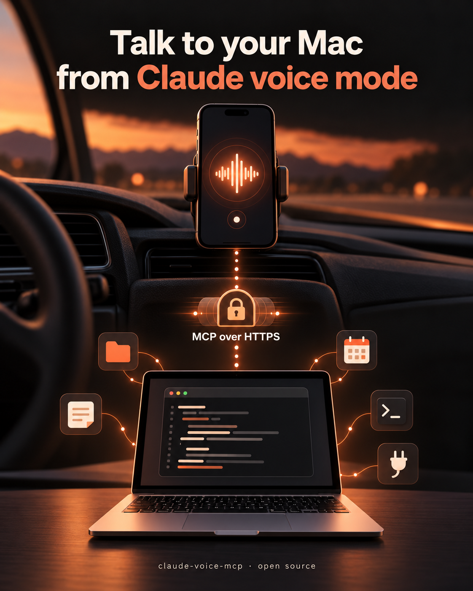

# claude-voice-mcp

<p align="center"></p>

Talk to **Claude Code on your Mac** while you drive, walk or cook, using the **voice mode of the Claude mobile app**.

The Claude app's voice mode can only use remote connectors (MCP servers reachable by URL). This small server is such a connector: it hands each spoken request to Claude Code running headless on your Mac, which keeps access to everything it normally has (local files, notes, CLIs, MCP servers, skills), and sends back a short answer written to be read aloud.

> "What's left on my to-do list for the client meeting tomorrow?"
> "Add a reminder to call the plumber on Thursday."
> "Find the last invoice from Acme in my email and tell me the amount."

## How it works

```
Claude app (voice) ──HTTPS──▶ tunnel (Cloudflare, Tailscale, ngrok…) ──▶ this server (127.0.0.1) ──▶ claude -p … ──▶ your tools
        ▲                                                                                                │
        └───────────────────────────────── short answer as the MCP tool result ◀─────────────────────────┘
```

- Requests go through a tunnel: no port is opened on your Mac or router.
- Each request runs `claude -p` with Sonnet, low effort and `--permission-mode auto`, plus a system prompt that asks for one to four plain sentences.
- Follow-up questions resume the same Claude Code session (`session_id`).
- Requests longer than about 50 seconds return a task id; the voice assistant fetches the result later.

### Tools

| Tool | What it does |
| --- | --- |
| `ask_claude_code` | Hands a request to Claude Code and returns a short spoken-style answer. |
| `get_task_result` | Fetches the result of a request that was still running. |

## Requirements

- macOS, with the Mac awake and online when you call it.
- [Claude Code](https://code.claude.com) installed and signed in (`claude` in `~/.local/bin`, or set `CLAUDE_BIN`).
- Node.js 20 or later.
- A Claude plan that allows custom connectors in the Claude app.
- A way to give your Mac a stable public HTTPS address. Pick one:

| Option | Own domain needed | How `/authorize` is protected |
| --- | --- | --- |
| **Cloudflare Tunnel** (recommended) | Yes, on Cloudflare | Cloudflare Access: sign-in with your email |
| **Tailscale Funnel** | No (`your-mac.your-tailnet.ts.net`) | A password |
| **ngrok** with a static domain | No | A password |

Avoid tunnels whose address changes at every restart (such as Cloudflare quick tunnels): the connector URL would break each time.

## Setup

1. **Install**
   ```bash
   git clone https://github.com/guillaume-gonano/claude-voice-mcp && cd claude-voice-mcp
   npm install && npm test
   mkdir -p data
   cp install.env.example data/install.env
   cp config.example.json data/config.json
   ```
   Edit both files (see [Configuration](#configuration)).
2. **Set up your tunnel** so that `https://<your host>` reaches `http://127.0.0.1:47851`. Then follow option A or B.

### A. Cloudflare Tunnel + Access

Requirements: a domain on Cloudflare, Cloudflare Zero Trust (the free plan is enough) and `cloudflared`. Optionally, the [`cf` CLI](https://developers.cloudflare.com/) logged in, so the installer can create the DNS record and Access application for you; otherwise create them in the dashboard.

1. In Cloudflare Zero Trust → Networks → Tunnels, create a remotely managed tunnel with a public hostname (for example `mcp.example.com`) pointing to `http://127.0.0.1:47851`. Save its token in `data/tunnel-token` (`chmod 600`).
2. In `data/install.env`, set `TUNNEL="cloudflare"` and fill in the Cloudflare lines.
3. Run `scripts/install.sh`. It creates the DNS record if needed and a Cloudflare Access application on `/authorize`, limited to your email. It then writes `data/config.json` and starts two LaunchAgents: the server and the tunnel. It ends with checks: `/mcp` must answer 401 and `/authorize` 302.

### B. Any other tunnel + password

1. Start your tunnel and keep it running. For example:
   - Tailscale Funnel: `tailscale funnel --bg 47851`
   - ngrok: `ngrok http --url=<your-static-domain> 47851`
2. In `data/install.env`, set `TUNNEL="other"` and `HOST` to the public hostname.
3. Run `scripts/install.sh`. It generates a random password (unless `password` is already set in `data/config.json`) and shows it once. It then starts the server as a LaunchAgent.

The password is asked only once, when you add the connector. Five wrong tries lock the page for 15 minutes.

### Then, for both options

**Add the connector** in the Claude app: Settings → Connectors → Add custom connector → `https://<your host>/mcp`. Sign in (Cloudflare Access or password) when asked. Then start voice mode and ask something.

## Configuration

`data/config.json` (personal, never committed):

| Key | Meaning |
| --- | --- |
| `userName` | Your first name, used in the prompts. |
| `toolsHint` | What Claude Code can reach on your Mac. The voice assistant reads it to decide when to call the tool. |
| `extraPrompt` | Extra instructions appended to the voice system prompt (language, house rules). |

The installer adds `publicUrl`, `port`, and either `access` (Cloudflare) or `password` (other tunnels; at least 16 characters).

Environment variables: `CLAUDE_BIN`, `VOICE_MCP_MODEL` (default `sonnet`), `VOICE_MCP_EFFORT` (default `low`) and `VOICE_MCP_WAIT_MS` (default `50000`).

## Security

**Read this before installing:** this connector gives a full Claude Code agent, running with your user account's rights, to whoever can use it.

The connector uses several layers of protection:

- **No inbound port.** The server listens on `127.0.0.1` only, and the tunnel client makes an outgoing connection.
- **OAuth 2.1 with PKCE.** `/mcp` refuses any request without a valid token (401).
- **Only the Claude apps can register as clients.** Only the claude.ai and claude.com callback URLs are accepted; anything else is refused with 400.
- **Tokens are issued only after your sign-in.** With Cloudflare, `/authorize` sits behind Cloudflare Access, limited to your email, and the server also checks the Access JWT signature, audience and email itself. With another tunnel, `/authorize` asks for your password, and five wrong tries lock it for 15 minutes. Cloudflare Access is stronger: a password can leak or be guessed, so keep the generated one.
- **Tokens are stored as SHA-256 hashes** in `data/oauth-state.json` (mode 0600). Access tokens last 24 hours; refresh tokens last 90 days and rotate on each use.
- **Two narrow tools**, with no direct shell access.
- **Claude Code's own guardrails stay on.** Auto permission mode applies, and the voice prompt forbids sending, publishing, deleting or paying unless you explicitly ask.

Remaining risks you should accept knowingly:

- **Your Claude account is the key.** Anyone signed in to it can use the connector, so protect it with strong sign-in (2FA or passkey).
- **Prompt injection is reduced, not eliminated.** An email or web page that Claude Code reads could contain hostile instructions.
- **"Always allow" removes a human check.** Setting the tools to "Always allow" in the Claude app means no confirmation before each call.

To cut access immediately, disconnect the connector in Claude, or stop the server:
```bash
launchctl bootout gui/$(id -u)/local.claude-voice-mcp
```
To revoke every token issued so far, delete `data/oauth-state.json` and restart the server.

## Limits

- Each request starts Claude Code, so expect roughly 10 seconds for a simple answer, and more for real work.
- Requests use your Claude Code usage or quota like any other session.
- The Mac must stay awake: for example, use `caffeinate`, or Energy settings that prevent sleep.

## Development

```bash
npm test   # OAuth flow, Access and password guards, and tools, with a fake Claude Code
```

## License

MIT. Not affiliated with Anthropic.
